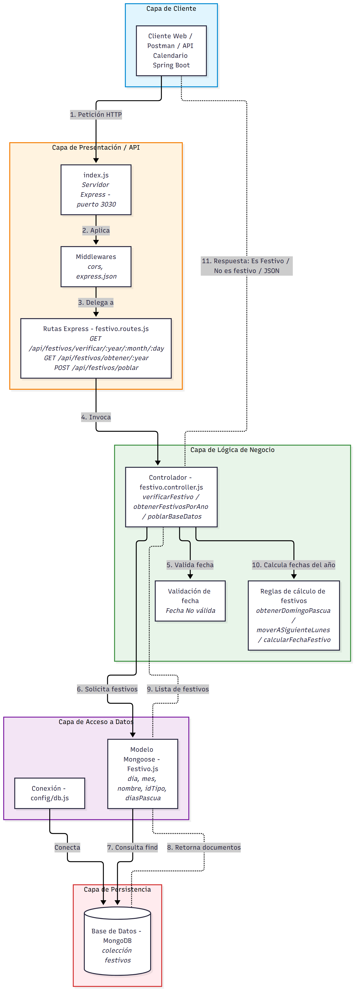
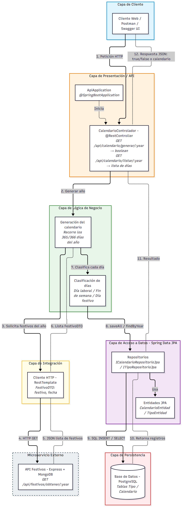
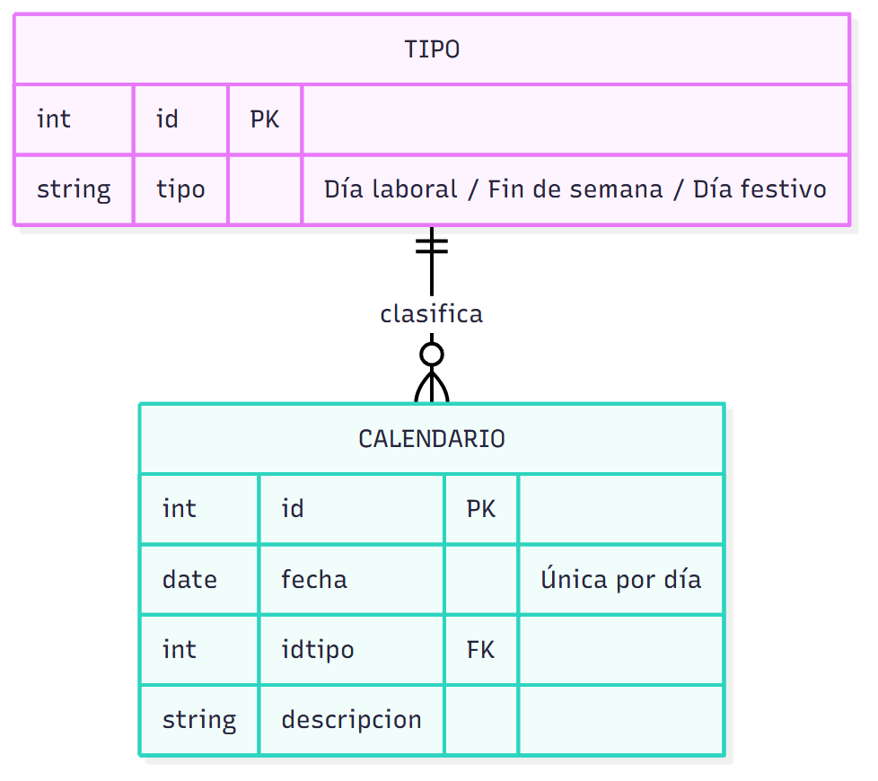
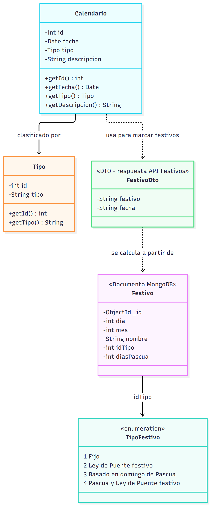

# Calendario Laboral + API Festivos (Arquitectura Onion + Seguridad JWT + Docker Compose)

Este repositorio contiene la solución distribuida completa de **Calendario Laboral y Días Festivos de Colombia**: dos microservicios contenerizados e interconectados con **Docker Compose**.

| # | Servicio / API | Tecnología | Carpeta |
|---|----------------|------------|---------|
| 1 | API Festivos + Swagger (`/api-docs`) | ExpressJS + MongoDB 7 | `/apiFestivos` |
| 2 | API Calendario Laboral + Tipos (JWT) | Spring Boot 3 (Java 21, Onion 5 módulos) + PostgreSQL 15 | `/apiMonedas` |
| 3 | Scripts de inicialización BD | SQL (PostgreSQL) + JS (MongoDB) | `/BD` |

### Endpoints principales

**API Festivos (`http://localhost:3030`)**
- Swagger UI: `http://localhost:3030/api-docs`
- `GET /api/festivos/verificar/{año}/{mes}/{día}` → *Es Festivo* / *No es festivo* / *Fecha No válida*
- `GET /api/festivos/obtener/{año}` → lista de festivos del año

**API Calendario y Tipos (`http://localhost:8080`, protegidos con Bearer JWT)**
- Swagger UI: `http://localhost:8080/swagger-ui/index.html`
- `GET /api/usuarios/validar/{nombreUsuario}/{clave}` → retorna el token JWT
- `GET/POST/PUT/DELETE /api/tipos/...` → CRUD de tipos de día
- `GET /api/calendario/generar/{año}` → consulta los festivos del año y persiste los días clasificados (`true`/`false`)
- `GET /api/calendario/listar/{año}` → retorna el calendario completo con los días clasificados

---

## 📐 Diagramas de Arquitectura (Mermaid)

### 1. Diagrama de Arquitectura por Capas - API Festivos (Express + MongoDB)



Código fuente: [`diagramas/festivos.mmd`](diagramas/festivos.mmd)

### 2. Diagrama de Arquitectura por Capas - API Calendario (Spring Boot + PostgreSQL)

Muestra la comunicación entre microservicios: la API Calendario consume vía HTTP GET la API Festivos.



Código fuente: [`diagramas/calendario.mmd`](diagramas/calendario.mmd)

---

## 💾 Modelado de Datos

### 3. Diagrama Relacional - BD Calendario (PostgreSQL)



### 4. Diagrama Objetual - Clases de ambas APIs



---

## 🏛️ Arquitectura Onion (5 módulos en `/apiMonedas`)

- `dominio`: Entidades puras (`Calendario`, `Tipo`, etc.) y DTOs (`FestivoDto`).
- `core`: Interfaces de servicios, repositorios e integración externa (`IFestivoServicioExterno`).
- `infraestructura`: Entidades JPA (`CalendarioEntidad`, `TipoEntidad`), mapeadores, repositorios JPA y cliente REST (`FestivoServicioExterno`).
- `aplicacion`: Lógica de negocio (`CalendarioServicio`, `TipoServicio`).
- `presentacion`: Controladores REST, configuración Swagger y seguridad Bearer JWT (`ConfiguracionSeguridad`).

---

## 🐳 Despliegue con Docker Compose (Arquitectura Onion + Seguridad JWT)

El archivo [`docker-compose.yml`](docker-compose.yml) levanta e interconecta los 4 contenedores en la red `redcalendario` (sin requerir compilación previa en el equipo anfitrión gracias al `Dockerfile` multi-stage con Maven + Java 21):

| Contenedor | Servicio | Puerto |
|------------|----------|--------|
| `dockerbdfestivos` | MongoDB 7 (base `festivos_db` precargada) | `27019:27017` |
| `dockerapifestivos` | API Festivos (ExpressJS + MongoDB + Swagger `/api-docs`) | `3030:3030` |
| `dockerbdcalendario` | PostgreSQL 15 (base `calendario` + tablas `tipo`, `calendario`, `usuario`) | `5435:5432` |
| `dockerapicalendario` | API Calendario + Tipos (Spring Boot 3 / Java 21 — Onion 5 módulos + JWT) | `8080:8080` |

Todos los servicios cuentan con `restart: unless-stopped`, `healthcheck` y variables de entorno inyectadas desde `docker-compose.yml`.

### 1. Levantar todo el sistema
```bash
docker compose up -d --build
```

### 2. Autenticación JWT y Swagger UI
- **Swagger API Festivos (ExpressJS):** `http://localhost:3030/api-docs`
- **Swagger API Calendario (Spring Boot):** `http://localhost:8080/swagger-ui/index.html`

Todos los endpoints de `/api/calendario/**` y `/api/tipos/**` están protegidos con Bearer JWT (devuelven `403 Forbidden` si no se envía token):

1. **Obtener token JWT:** `GET http://localhost:8080/api/usuarios/validar/admin/admin123`
2. En Swagger UI (`8080`) o Postman, autorizar usando `Authorization: Bearer <token>`
3. **Endpoints de Calendario y Tipos:**
   - `GET /api/tipos/`, `GET /api/tipos/obtener/{id}`, `GET /api/tipos/buscar/{nombre}`, `POST /api/tipos/`, `PUT /api/tipos/`, `DELETE /api/tipos/{id}`
   - `GET /api/calendario/generar/{año}` (ej. `2026`, `2027`)
   - `GET /api/calendario/listar/{año}`

### 3. Pruebas automatizadas de integración (PowerShell)
```powershell
powershell -ExecutionPolicy Bypass -File "test-integracion-calendario.ps1"
```

Ver guía de entrega y evidencias en [`EVIDENCIA_ACTIVIDAD_5.md`](EVIDENCIA_ACTIVIDAD_5.md).
